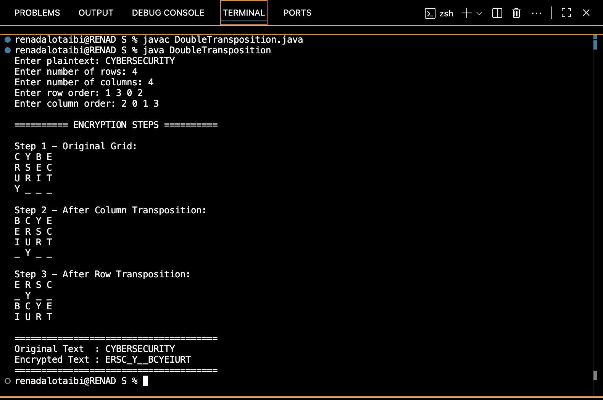
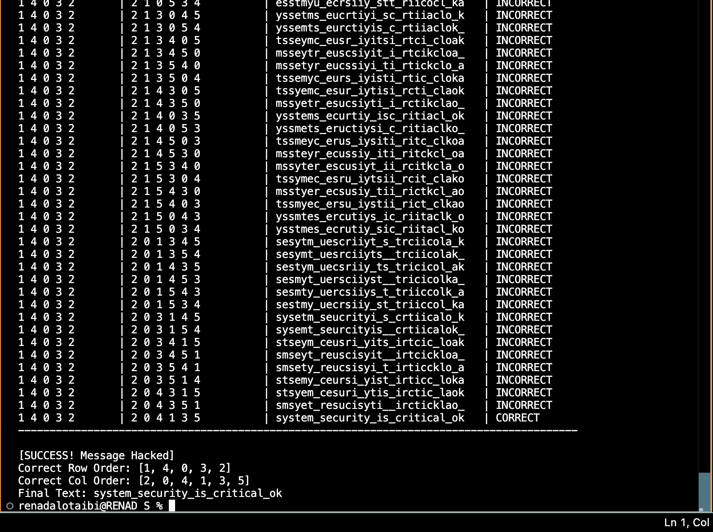
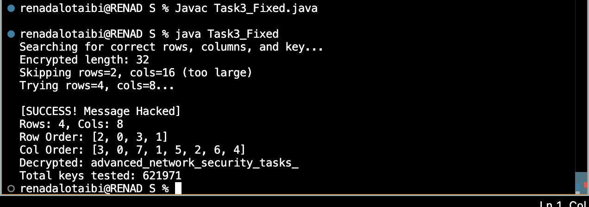

# 🔐 Double Transposition Cipher

A Java-based cryptography project demonstrating the *Double Transposition Cipher*, brute-force decryption, and cryptanalysis using permutation-based key searching.

## 📖 Project Overview

This project explores classical cryptography by implementing a Double Transposition Cipher in Java.

It demonstrates how plaintext can be encrypted by rearranging rows and columns, and how encrypted messages can be recovered by searching possible permutation keys.

## ✨ Features

•⁠  ⁠Double Transposition Cipher encryption
•⁠  ⁠Step-by-step encryption visualization
•⁠  ⁠Row and column permutation techniques
•⁠  ⁠Brute-force key searching
•⁠  ⁠Automatic grid dimension detection
•⁠  ⁠Decryption and key recovery
•⁠  ⁠Detailed cryptanalysis results

## 🛠️ Technologies Used

•⁠  ⁠*Programming Language:* Java
•⁠  ⁠*Cryptography:* Double Transposition Cipher
•⁠  ⁠*Algorithms:* Permutations and Brute-Force Search
•⁠  ⁠*Development Environment:* Visual Studio Code
•⁠  ⁠*Tools:* Java Development Kit (JDK)

## 📂 Project Structure

⁠ text
Double-Transposition-Cipher/
│
├── DoubleTransposition.java
├── Task2.java
├── Task3_Fixed.java
├── README.md
│
└── Screenshot/
    ├── encryption.png
    ├── brute-force.png
    └── cryptanalysis.png
 ⁠

## 🚀 How to Run

### 1. Double Transposition Encryption

Compile and run:

⁠ bash
javac DoubleTransposition.java
java DoubleTransposition
 ⁠

The program accepts plaintext, grid dimensions, and permutation keys, then displays each encryption stage.

### 2. Brute-Force Decryption

⁠ bash
javac Task2.java
java Task2
 ⁠

The program searches different row and column permutations to identify the correct keys and recover the original message.

### 3. Cryptanalysis and Key Recovery

⁠ bash
javac Task3_Fixed.java
java Task3_Fixed
 ⁠

The program searches possible grid dimensions and permutation keys to recover encrypted plaintext.

## 📸 Screenshots

### 🔹 1. Double Transposition Encryption

The program demonstrates three encryption stages:

1.⁠ ⁠Original plaintext grid
2.⁠ ⁠Column transposition
3.⁠ ⁠Row transposition

*Original Text:* ⁠ CYBERSECURITY ⁠

*Encrypted Text:* ⁠ ERSC_Y__BCYEIURT ⁠

---

### 🔹 2. Brute-Force Decryption

The program evaluates different permutation combinations until it identifies the correct encryption keys.

*Recovered Row Order:* ⁠ [1, 4, 0, 3, 2] ⁠

*Recovered Column Order:* ⁠ [2, 0, 4, 1, 3, 5] ⁠

*Decrypted Message:*
⁠ system_security_is_critical_ok ⁠

---

### 🔹 3. Cryptanalysis and Key Recovery

The program automatically searches for valid grid dimensions and permutation keys.

*Results:*

•⁠  ⁠Grid Dimensions: ⁠ 4 × 8 ⁠
•⁠  ⁠Row Order: ⁠ [2, 0, 3, 1] ⁠
•⁠  ⁠Column Order: ⁠ [3, 0, 7, 1, 5, 2, 6, 4] ⁠
•⁠  ⁠Total Keys Tested: *621,971*

*Decrypted Message:*
⁠ advanced_network_security_tasks_ ⁠

## 📊 Project Results

| Feature | Result |
|---------|--------|
| Double Transposition Encryption | Successful |
| Brute-Force Decryption | Successful |
| Permutation Key Recovery | Successful |
| Grid Dimension Detection | Successful |
| Candidate Keys Tested | 621,971 |
| Programming Language | Java |

## 🎯 Learning Outcomes

Through this project, I gained practical experience in:

•⁠  ⁠Implementing classical cryptographic algorithms
•⁠  ⁠Understanding transposition-based encryption
•⁠  ⁠Working with two-dimensional arrays in Java
•⁠  ⁠Generating and testing permutation keys
•⁠  ⁠Applying brute-force techniques to cryptanalysis
•⁠  ⁠Understanding the security limitations of classical ciphers

## 🔒 Security Note

The Double Transposition Cipher is a classical encryption technique intended for educational purposes. It is not suitable for protecting sensitive information in modern security systems.

---

*Java | Cryptography | Cybersecurity | Algorithm Analysis*
